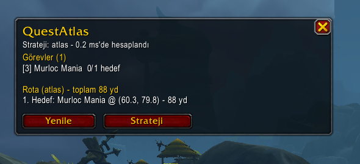
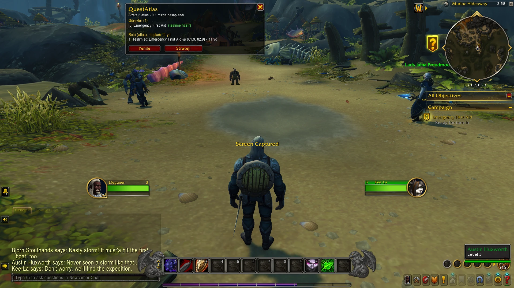

# QuestAtlas

**World of Warcraft: Forever için görev takipçisi + ATLAS algoritmasıyla en kısa görev rotası.**

QuestAtlas gerçek bir WoW eklentisidir (Lua 5.1). Görev günlüğündeki görevleri takip eder, hangi görevin
nerede yapılacağını kendi küçük veritabanından bulur ve hocanın **ATLAS** algoritmasıyla
([github.com/savastakan/atlas](https://github.com/savastakan/atlas)) tüm görevleri bitiren kısa bir rota
hesaplar. Rota, oyunda taşınabilir bir pencerede ve `/qa` komutlarıyla gösterilir.

Oyunu açmadan denemek için `tools/mock/WowMock.lua` var: WoW istemcisini taklit eden bir katman.
Eklentinin **gerçek kodu**, oyundaki gibi `.toc` dosyası sırasıyla yüklenip bu katmanda çalıştırılır.

Eklenti hem **WoW: Forever** (1.60.1, arayüz 16001) hem de **normal WoW / retail** (12.1.5, arayüz 120105)
için hazırlandı. Retail'de, veritabanında olmayan görevlerin yeri oyunun kendi harita işaretlerinden okunur.

---

## Klasör yapısı

```
QuestAtlas/                  <- repo kökü
├─ QuestAtlas/               <- OYUNA KOPYALANACAK eklenti klasörü
│  ├─ QuestAtlas.toc         <- WoW'un okuduğu manifest (dosya sırası, SavedVariables)
│  ├─ Core/                  <- sınıf sistemi, Interface, EventBus, yardımcılar
│  ├─ Locales/               <- Türkçe / İngilizce metinler
│  ├─ Algorithm/             <- ATLAS'ın Lua portu (Atlas, Graph, Edge, maliyet stratejileri)
│  ├─ Domain/                <- Location, Quest, Route modelleri
│  ├─ Data/                  <- görev veritabanı (örnek: Elwynn Forest), harita ölçüleri
│  ├─ Services/              <- WoW API adaptörü, repository, factory, mesafe hesabı, ayarlar
│  ├─ Routing/               <- görev -> graf dönüşümü, rota stratejileri, planlayıcı
│  ├─ Tracker/               <- QuestTracker (durum + olay yayını)
│  ├─ UI/                    <- pencere, presenter, widget factory
│  ├─ Commands/              <- /qa komutları (Chain of Responsibility)
│  ├─ QuestAtlasFacade.lua   <- Facade: dışarıya açılan tek giriş noktası
│  └─ Bootstrap.lua          <- Composition root: nesneleri kurar, oyun olaylarını bağlar
├─ tools/
│  ├─ mock/WowMock.lua       <- OYUNUN YERİNE GEÇEN KATMAN (WoW API simülasyonu)
│  ├─ mock/MockWorldData.lua <- simülasyonun "sunucu" verisi
│  ├─ run_tests.lua          <- tüm testleri çalıştırır
│  ├─ demo.lua               <- oyunu oynuyormuş gibi adım adım senaryo (retail için: demo.lua retail)
│  ├─ install_addon.ps1      <- eklentiyi oyunun AddOns klasörüne kurar
│  ├─ build_diagrams_html.py <- diyagram sayfasını üretir
│  └─ reference/             <- hocanın Java kodunu çalıştırıp beklenen çıktıları üreten araç
├─ tests/                    <- 82 test + Java referans çıktıları
└─ docs/
   ├─ TASARIM.md             <- mimari, ATLAS, SOLID, tasarım desenleri, olası sorular
   └─ diagrams/              <- Mermaid kaynakları + yazdırılabilir diyagramlar.html
```

## Oyunsuz çalıştırma (test + demo)

1. Lua 5.1 uyumlu bir yorumlayıcı kur (bir kere):
   ```powershell
   winget install DEVCOM.LuaJIT
   ```
   Yeni bir terminal aç (PATH yenilensin).
2. Repo kökünde testleri çalıştır:
   ```powershell
   luajit tools/run_tests.lua
   ```
   Beklenen son satır: `82 passed, 0 failed (Lua 5.1)`.
   Sadece bir grubu çalıştırmak için filtre ver: `luajit tools/run_tests.lua atlas`
3. Oyunu "oynayan" demo (görev al, teslim et, komut yaz, pencereyi terminale çiz):
   ```powershell
   luajit tools/demo.lua
   ```
   Retail senaryosu (Exile's Reach, oyunun harita işaretleri):
   ```powershell
   luajit tools/demo.lua retail
   ```
   Türkçe karakterler bozuk görünürse önce `chcp 65001` yaz.

## Oyuna kurulum

Kurulum betiği WoW klasörünü bulur, istemcinin sürümünden arayüz numarasını hesaplayıp `.toc`'a ekler ve
eklentiyi `Interface\AddOns\QuestAtlas` olarak kurar:

```powershell
powershell -ExecutionPolicy Bypass -File tools\install_addon.ps1
```

- Varsayılan: **retail** (`_retail_`). WoW: Forever için `-Flavor forever` ekle.
- Varsayılan olarak bir **bağlantı** (directory junction) kurar: AddOns klasöründeki `QuestAtlas`, bu
  repodaki `QuestAtlas` klasörünü gösterir. Kodda yapılan her değişiklik oyunda `/reload` ile gelir.
  Bağımsız bir kopya istersen `-Copy` ekle; kaldırmak için `-Uninstall`.
- Bu bilgisayarda retail için kurulum **yapıldı**:
  `C:\Program Files (x86)\World of Warcraft\_retail_\Interface\AddOns\QuestAtlas` -> bu repodaki
  `QuestAtlas` klasörü.

`.toc` dosyasındaki arayüz numaraları: `16001` (Forever 1.60.1, CurseForge'daki Forever eklentilerinden
alındı, doğrulanmadı) ve `120105` (retail 12.1.5, kurulu istemcinin `.build.info` dosyasından).
Oyun eklentiyi "out of date" sayarsa karakter seçim ekranındaki AddOns menüsünde
"Load out of date AddOns" kutusunu işaretle.

## Oyunda ilk deneme (retail)

1. Karakter seçim ekranı -> **AddOns** -> QuestAtlas açık olsun.
2. Oyunda sohbet kutusuna:
   - `/console scriptErrors 1` -> Lua hataları ekranda görünür (hata çıkarsa metnini kopyala).
   - `/qa debug` -> istemci sürümü, API'ler, konum, görevlerin konum kaynağı. Sorun bildirirken bunu gönder.
   - `/qa help` -> komut listesi.
3. Bir iki görev al. Pencerede görevler ve rota görünmeli. Retail'de rota oyunun harita işaretlerinden
   gelir; açık görevlerde önce hedef bölgesi görünür, hedefler bitince teslim NPC'si rotaya eklenir.

## Komutlar (`/qa` veya `/questatlas`)

| Komut | Ne yapar |
|---|---|
| `/qa help` | komut listesi |
| `/qa toggle`, `/qa show`, `/qa hide` | takip penceresi |
| `/qa route` | tüm rotayı sohbete yazar |
| `/qa next` | sıradaki durak (istemci destekliyorsa haritaya işaret koyar) |
| `/qa strategy [atlas/nearest/bruteforce]` | rota algoritmasını seç ya da sıradakine geç |
| `/qa compare` | üç algoritmayı aynı görevlerde karşılaştırır |
| `/qa available` | şu an alınabilecek görevler (en yakın önce) |
| `/qa plan add <id>` / `remove <id>` / `list` / `clear` | henüz alınmamış görevleri rotaya ekle |
| `/qa refresh` | yeniden hesapla |
| `/qa lang tr` / `/qa lang en` | dil |
| `/qa debug` | tanılama: istemci sürümü, API'ler, konum, görevlerin konum kaynağı |

## Diyagramlar

`docs/diagrams/diyagramlar.html` dosyasını tarayıcıda aç (Mermaid kütüphanesi için internet gerekir)
ve **Yazdır / PDF olarak kaydet**. Her diyagram ayrı sayfaya, kendi yönünde (yatay/dikey) basılır;
her birinin altında **SVG indir** düğmesi var. Kaynaklar `docs/diagrams/*.mmd` dosyalarında.
Değiştirirsen sayfayı yeniden üret: `python tools/build_diagrams_html.py`.

7 numaralı diyagram, elle çizmek / ezberlemek için sadeleştirilmiş sürümdür.

## ATLAS doğrulaması

`tests/fixtures/atlas_java_expected.lua`, hocanın **orijinal Java kodu** çalıştırılarak üretildi
(`tools/reference/generate_expected.py`). Lua portu bu 9 grafın hepsinde Java ile birebir aynı
yürüyüşü üretiyor. Ayrıntılar ve bulunan "son kenar" davranışı için `docs/TASARIM.md`.

## Gerçek oyunda doğrulama

Eklenti 26.11.2026'da retail istemcide (12.1.5) yeni bir karakterle Exile's Reach'te denendi; Lua
hatası çıkmadı. Ekran görüntüleri `docs/oyun/` klasöründe:

| Görüntü | Ne gösteriyor |
|---|---|
|  | İlk görev: yer oyunun harita işaretinden okundu, rota 88 yd |
|  | Hedefler bitince rota "Teslim et" adımına geçti; teslim NPC'si tam orada |

Diğerleri: `01` ilk yükleme, `02`/`03` gemide ve adada `/qa debug`, `05` "oyun işareti: 1",
`06` oyunun haritasındaki görev işareti, `07` `/qa next` ile konan harita iğnesi. Ayrıntı:
`docs/TASARIM.md` bölüm 7.1.

## Bilinen sınırlar

- Görev veritabanı **örnek veri**: Elwynn Forest'taki 17 Alliance görevi (Classic / Forever),
  koordinatlar yaklaşık. Aynı formatta yeni görev eklenebilir.
- Retail'de konumlar oyunun harita işaretlerinden (`C_QuestLog.GetQuestsOnMap`,
  `C_QuestLog.GetNextWaypoint`) okunur. Çağrılar `pcall` ile korunuyor; bir sürümde biçim değişirse
  eklenti çökmez, sadece o görevler "Konum verisi yok" olur.
- Retail'de açık bir görevin teslim NPC'si, hedefler bitene kadar bilinmez (oyun da göstermez); rota
  önce hedef bölgelerini içerir.
- Bazı yerlerde (ör. Exile's Reach'in başındaki gemi) oyun eklentilere koordinat vermez; orada
  "konum bilinmiyor" görünür, rota çizilmez.
- Gerçek istemcide denenen sürüm retail 12.1.5 (yukarıdaki bölüm). WoW: Forever istemcisinde denenmedi;
  eski görev API'si (`GetQuestLogTitle`) simülasyonda test edildi.
- WoW'da Türkçe istemci yok; dil, eklentinin kendi ayarıdır (`/qa lang`).
